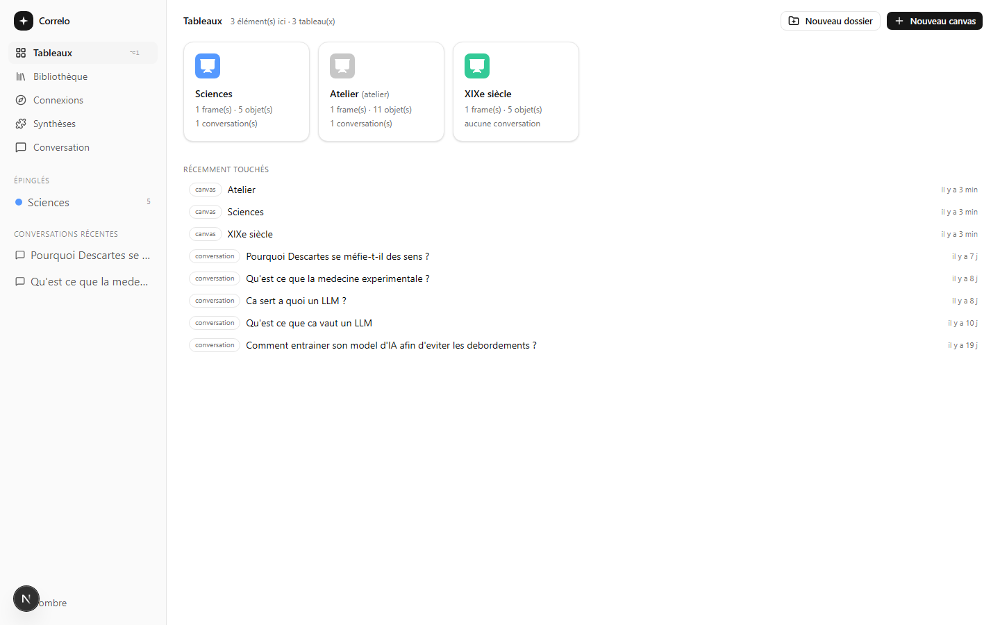

# Correlo

A personal, **local-first** connection engine. Correlo takes your documents, splits them
into fragments, embeds them, and then looks for the **non-obvious links** between them —
the ones a keyword search would never surface. Every lead is offered, never imposed: you
accept it, reject it, or dig into it in conversation.

A link that rests only on a shared rare word, or on two fragments of the same document, is
ruled out by an explicit filter (`lib/discover/claim-rules.ts`): the engine never presents
as a discovery what was already findable.



*The explorer is the home screen: your boards, what each one holds, and what you touched
last. The interface is in French.*

## Requirements

- **Node.js 20+** (Next.js 16).
- Embeddings: **Ollama** running locally with `nomic-embed-text` (the default), or any
  OpenAI-compatible endpoint via `EMBED_PROVIDER=api`.
- A chat model: **Groq** by default (`GROQ_API_KEY`), or Ollama locally.

## Getting started

```bash
npm install
cp .env.example .env.local   # fill in GROQ_API_KEY at minimum
npm run dev
```

The app listens on <http://localhost:3000>. The SQLite database is **created and migrated
automatically on startup**: `instrumentation.ts` applies everything in `migrations/` and
then starts the job worker. No manual setup step.

> **Correlo cannot be hosted.** The database is a SQLite file, and ingestion, discovery and
> synthesis all run inside the server's own worker: it needs a writable persistent disk
> **and** a process that stays alive. A serverless host provides neither — and a deployment
> that did succeed would be an empty app anyway, since the corpus is local and git-ignored.
> That is what "local-first" means here: the corpus never leaves the disk, and the only
> things that go out are the ones you configure (`LLM_CHAT_PROVIDER`, `SEARCH_PROVIDER`).

## Screens

| Route | Purpose |
| --- | --- |
| `/` | The board explorer — the home screen. The app opens on your boards, not on a document |
| `/canvas/<id>` | The workshop for one board: drop files, review suggestions, preview (`/canvas` leads there) |
| `/conversation` | Conversation over the corpus; this is where connections get argued about |
| `/sources` | The documents ingested, and the state of their processing |
| `/suggestions` | The connections found, to accept or reject |
| `/syntheses` | The syntheses produced around a theme |

## Configuration

Everything is documented in `.env.example`. The settings that change behaviour:

| Variable | Default | Effect |
| --- | --- | --- |
| `DATABASE_PATH` | `./data/correlo.db` | Local SQLite database. This *is* the whole corpus: backing it up is backing up the work |
| `LLM_CHAT_PROVIDER` | `groq` | `groq` or `ollama`. **No automatic fallback** between the two |
| `GROQ_API_KEY` | — | Required when `LLM_CHAT_PROVIDER=groq` |
| `EMBED_PROVIDER` | `ollama` | `ollama` (local, 768 dims) or `api` (2048 dims) |
| `NVIDIA_API_KEY` | — | Required when `EMBED_PROVIDER=api` on `integrate.api.nvidia.com` |
| `SEARCH_PROVIDER` | `none` | `exa` turns on the agent's web search. `none` ⇒ the web tools **do not exist** |
| `WORKSPACE_ROOT` | empty | Local directory the agent may **read**, read-only. Empty ⇒ the tool does not exist |

> **Changing `EMBED_PROVIDER` switches the embedding space.** A vector only means something
> in the space that produced it: after a change, run `npm run reembed` (`--dry-run` to look
> first). Until the corpus is aligned, the analysis refuses to compare two spaces rather
> than produce false links.

Credentials are read from `.env.local`, which is never committed.

## Commands

```bash
npm run dev         # development server (migrations + worker)
npm run build       # production build
npm run start       # production server
npm run lint        # ESLint
npm run typecheck   # tsc --noEmit
```

Long-running corpus work — **the server must be running** (`npm run dev`), because its
worker is what executes the jobs; these scripts only enqueue one and follow along:

```bash
npm run discover    # a discovery run (paths and options: --help in scripts/discover.mjs)
npm run reingest    # re-ingest sources (after a chunking change)
npm run reembed     # re-embed the corpus into the active space
npm run synth       # produce syntheses
```

## Layout

```
app/          routes (pages) and API
components/   interface (explorer, workshop, conversation)
lib/          the engine: ingestion, embeddings, discovery, jobs, conversation
migrations/   SQLite schema, applied on startup
scripts/      CLIs for long-running work
data/         local SQLite database (git-ignored)
```

## License

MIT — see [LICENSE](LICENSE).
